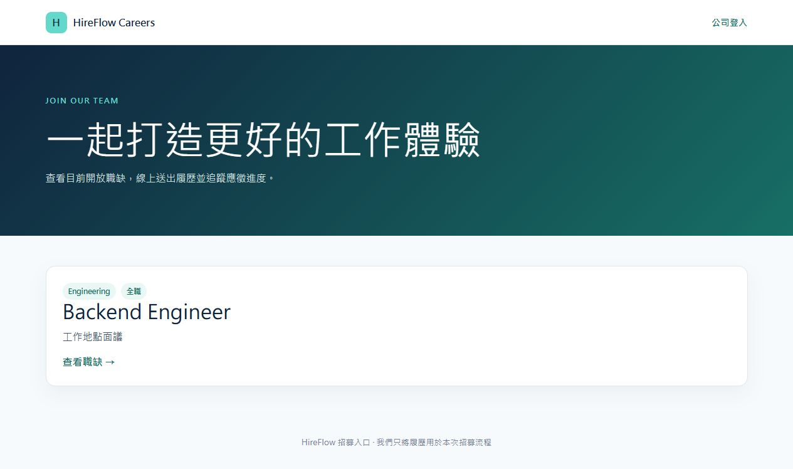
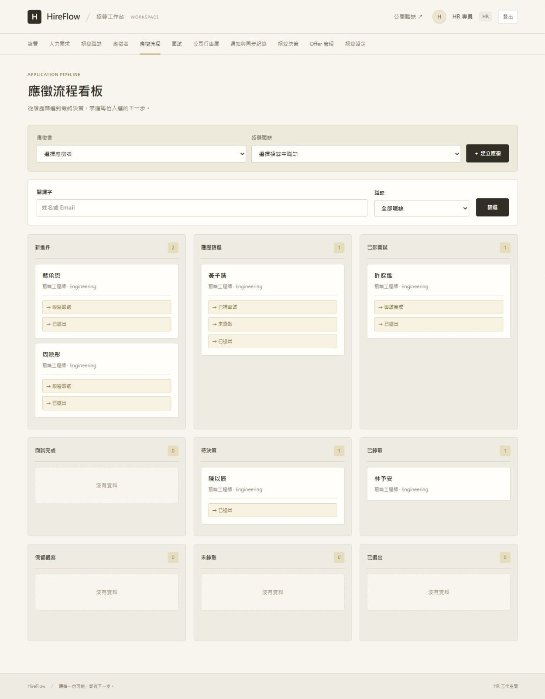
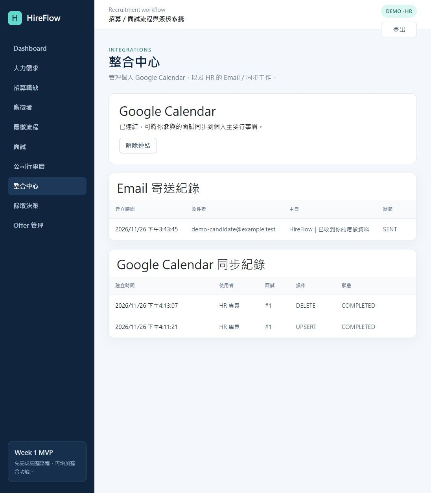

# HireFlow｜招募流程、面試協作與求職者入口平台

HireFlow 是一個整合人力需求簽核、公開職缺、應徵者管理、面試協作、錄取決策、Offer 與外部通知的全端招募系統。專案採 Monorepo 管理，前端使用 Vue 3，後端使用 Spring Boot，資料庫使用 PostgreSQL。

這是我的個人全端作品集專案，重點不只在完成 CRUD，而是實作企業招募中常見的角色權限、部門資料隔離、狀態流程、稽核紀錄、非同步通知及第三方整合。

## 畫面預覽

以下為開發環境畫面，履歷與面試資料均為虛構展示資料。

### HR 工作台


### 公開職缺與求職者進度




### 招募看板與公司行事曆






## 核心功能一覽

| 模組 | 主要功能 |
| --- | --- |
| 帳號與權限 | Session 登入、CSRF、ADMIN／HR／用人主管／面試官角色權限 |
| 人力需求 | 建立需求、送審、HR 核准／退回／拒絕、核准後建立職缺 |
| 公開職缺 | 公開職缺列表、職缺詳情及求職者線上應徵 |
| 應徵者 | 基本履歷、自傳、作品集、多筆工作經歷及 PDF 履歷版本 |
| 應徵流程 | 招募看板、階段轉換、狀態歷程及求職者進度查詢 |
| 面試 | 面試安排、撞期檢查、面試官指派、自助選時及公司行事曆 |
| 評分與決策 | 評分表鎖定／解鎖、評分彙整、錄取決策與前置條件檢查 |
| Offer | 草稿、送審、主管核准／退回、寄送、接受／拒絕及到期提醒 |
| 外部整合 | Gmail SMTP、Email Outbox、Google Calendar OAuth 與事件同步 |
| 管理與稽核 | 整合工作紀錄、失敗重試、全域 Audit Log 與部門資料隔離 |

## 技術重點

- 採用 Controller → Service → Repository → Entity 的嚴謹分層，Request／Response 使用獨立 DTO。
- 使用 Spring Security、HttpSession、BCrypt 與 CSRF Token 保護登入及狀態修改請求。
- 依角色與部門限制人力需求、面試、履歷、Offer 及公司行事曆的查詢範圍。
- 透過狀態機概念限制人力需求、Application、Interview 與 Offer 的合法轉換。
- 使用樂觀鎖與交易確保招募流程更新的一致性。
- 使用 Email Outbox 保存寄信工作，讓商業交易與外部 SMTP 呼叫解耦並支援重試。
- 透過 OAuth `state` 驗證與 AES-GCM 加密保護 Google Calendar Token。
- PDF 履歷驗證檔頭、大小與正規化路徑，避免偽造檔案、越權下載及 Path Traversal。
- 關鍵操作寫入 Audit Log，保存操作人、結果、目標資料與時間。

## 系統架構

```text
求職者／公司使用者
        │
        ▼
Vue 3 + Vite
Vue Router / Pinia / Axios / Bootstrap
        │
        │ REST API / Session / CSRF
        ▼
Spring Boot 4
Auth / Requisition / Candidate / Interview
Decision / Offer / Audit / Integration
        │
        ▼
Spring Data JPA / Hibernate / Flyway
        │
        ▼
PostgreSQL

External Services
Google Calendar OAuth 2.0 / Gmail SMTP
```

## 技術棧

### Frontend

- Vue 3、Vite、Vue Router
- Pinia、Axios、Bootstrap 5
- HTML5、CSS3、JavaScript
- Vitest

### Backend

- Java 17、Spring Boot 4
- Spring MVC、Spring Security、HttpSession
- Spring Data JPA、Hibernate、Bean Validation
- Spring Mail、Scheduler、OpenAPI／Swagger
- Maven、JUnit、Spring Boot Test、H2 Test Database

### Data & Integration

- PostgreSQL、Flyway
- Google Calendar OAuth 2.0
- Gmail SMTP
- AES-256-GCM Token Encryption
- Docker Compose
- GitHub Actions

## 安全設計

- API Secret、資料庫密碼、SMTP 應用程式密碼及 OAuth 憑證不提交至 Git。
- 真實設定放在被忽略的 `.env`，Repository 只保留 `.env.example`。
- 使用 BCrypt Hash 保存密碼，後端 Session 管理登入狀態。
- Cookie 與 Header 搭配 CSRF Token 保護狀態修改 API。
- 受保護 API 依登入狀態與權限回傳 401 或 403。
- Google Token 以 AES-256-GCM 加密後才寫入資料庫。
- Candidate Portal 使用有期限的雜湊 Token，不直接暴露資料庫 ID。
- PDF 履歷使用 UUID 儲存名稱，並驗證檔案格式、大小與正規化路徑。
- 用人主管只能存取自己部門的招募資料、行事曆及履歷。

## Repository 結構

```text
HireFlow/
├── backend/                     # Spring Boot REST API
│   ├── src/main/java/           # 分層後端模組
│   ├── src/main/resources/      # 設定與 Flyway Migration
│   └── src/test/                # 整合測試
├── frontend/                    # Vue 3 SPA
│   ├── src/views/
│   ├── src/services/
│   ├── src/stores/
│   └── tests/
├── docs/                        # 各階段功能與驗收文件
├── .github/workflows/           # CI
├── compose.yaml                 # 本機 PostgreSQL
└── README.md
```

## 本機啟動

### 環境需求

- JDK 17
- Node.js 22 與 npm
- Docker Desktop，或自行安裝 PostgreSQL

### 1. 建立本機設定並啟動 PostgreSQL

```powershell
Copy-Item .env.example .env
docker compose up -d
```

`.env` 內的值只供本機使用，請勿提交真實的 Gmail、Google OAuth 或資料庫憑證。

預設 `local` profile 會從啟動目錄或上一層讀取 `.env`，支援在專案根目錄或 `backend/` 啟動。使用 `KEY=value` 格式，不加引號；Google 應用程式密碼移除空格。IDE／作業系統環境變數優先於 `.env`，若保留舊值需更新或移除。

### 2. 啟動 Backend

Windows：

```powershell
cd backend
.\mvnw.cmd spring-boot:run
```

macOS／Linux：

```bash
cd backend
./mvnw spring-boot:run
```

- Backend：`http://localhost:8080`
- API Health：`http://localhost:8080/api/health`
- Swagger UI：`http://localhost:8080/swagger-ui.html`

### 3. 啟動 Frontend

```bash
cd frontend
npm install
npm run dev
```

- Frontend：`http://localhost:5173`
- 公開職缺：`http://localhost:5173/careers`

## Demo 登入

四組 Demo 帳號共用密碼：`HireFlow123!`

| 角色 | Email | 主要權限 |
| --- | --- | --- |
| ADMIN | `admin@hireflow.local` | 全系統管理與稽核 |
| HR | `hr@hireflow.local` | 招募流程、Offer 與整合工作 |
| HIRING_MANAGER | `manager@hireflow.local` | 自己部門的簽核、面試與錄取決策 |
| INTERVIEWER | `interviewer@hireflow.local` | 被指派面試的查看與評分 |

## 驗證指令

```powershell
# Backend
cd backend
.\mvnw.cmd test

# Frontend
cd ..\frontend
npm run test
npm run build
```

目前自動化驗證結果：

- Backend：核心流程及外部派送交易整合測試（最新結果以測試報告為準）
- Frontend：18 項測試通過
- Frontend production build 通過
- GitHub Actions 會在 `main`、`codex/**` 與 Pull Request 執行前後端驗證
- CI 使用獨立 PostgreSQL 17 驗證全新資料庫的 Flyway Migration 與 Hibernate Schema；H2 測試不會讀取本機 `.env` 或寄出信件。

Gmail 設定完成後，可在 `backend/` 用下列指令只驗證 SMTP 登入，不寄信：

```powershell
$env:HIREFLOW_SMTP_TEST='true'
.\mvnw.cmd -Dtest=GmailConnectionIntegrationTests test
Remove-Item Env:HIREFLOW_SMTP_TEST
```

## 完成階段

- Day 1–2：Monorepo、PostgreSQL、Flyway、Session 登入、CSRF 與角色權限。
- Day 3–6：人力需求、職缺、應徵者、招募看板、面試、評分、錄取決策與 Audit Log。
- Day 7–9：CI、OpenAPI、公開職缺、求職表單、安全查詢連結與進度時間軸。
- Day 10–13：面試選時、部門行事曆、Email Outbox、Gmail、Google Calendar 與整合中心。
- Day 14：Offer 簽核與回覆、到期提醒，以及安全的 PDF 履歷附件。

詳細功能與設定說明位於 [`docs/`](docs/)；Day 10–13 外部整合設定見 [`docs/DAY10-13.md`](docs/DAY10-13.md)，Day 14 Offer 與附件見 [`docs/DAY14.md`](docs/DAY14.md)。

## 專案說明

- 此 Repository 是個人全端作品集，目前以本機可完整操作與測試為目標。
- Google Calendar 與 Gmail 功能需要自行建立 OAuth／SMTP 憑證後才會實際呼叫外部服務。
- Gmail 實際寄送已驗證；Google Calendar 真實帳號授權、事件新增及取消同步已驗證。面試改期尚無公司端操作入口，不能視為已完成的端到端功能。完整待辦與派送限制見 [`公開前驗收清單`](docs/PUBLIC_RELEASE_CHECKLIST.md)。
- 正式部署前仍需依實際網域、Secret Manager、TLS、物件儲存與資料庫環境調整設定。

---

Portfolio maintained by **Frank Tsao**

[GitHub：tsaoworkspace-hub](https://github.com/tsaoworkspace-hub)
