# HireFlow｜招募流程、面試協作與求職者入口平台

HireFlow 是一個整合人力需求簽核、公開職缺、應徵者管理、面試協作、招募決策、Offer 與外部通知的全端招募系統。專案採 Monorepo 管理，前端使用 Vue 3，後端使用 Spring Boot，資料庫使用 PostgreSQL。

這是我的個人全端作品集專案，著重企業招募中的角色權限、部門資料隔離、流程狀態、稽核追蹤、非同步通知及第三方整合。求職者可在線上投遞履歷、選擇面試時段、追蹤進度與回覆 Offer；公司使用者則依角色參與招募協作。

[核心功能](#核心功能一覽) · [可設定簽核與標準職稱](#可設定簽核與標準職稱) · [技術重點](#技術重點) · [本機啟動](#本機啟動) · [Demo 登入](#demo-登入)

## 畫面預覽

以下截圖擷取自 2026-11-27 的本機開發版本，呈現暖白、芥末金與深棕色的介面。新版介面與可設定簽核功能的程式碼尚未同步至本 Repository，下載版本請以其程式碼為準。

截圖使用獨立展示資料庫，姓名、履歷、薪資與 Offer 均為虛構資料。展示環境停用 Gmail 與 Google Calendar 的實際派送，因此畫面中的通知工作會保留在等待處理狀態。

### 公開招募與企業登入

求職者從公開招募頁探索職缺；公司使用者由獨立登入入口進入工作台。


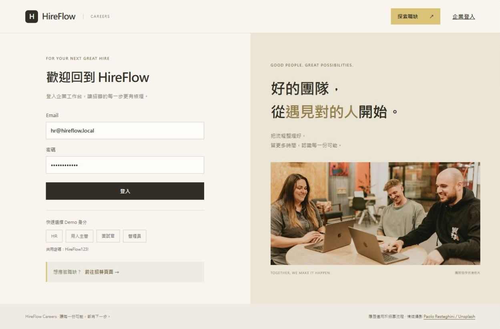

### HR 工作台

集中查看待審需求、近期面試與人選階段分布。

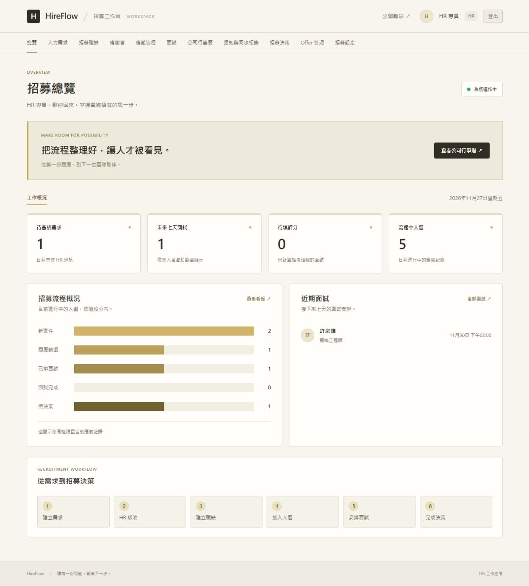

### 招募看板與公司行事曆

招募看板採三欄排列；公司行事曆整合月曆與每日面試明細，Google Calendar 連結入口也集中於此。


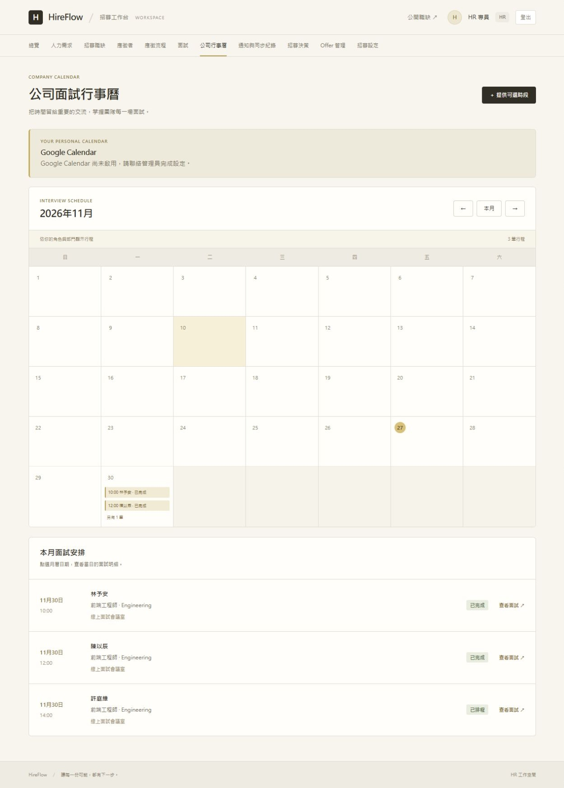

<details>
<summary>查看簽核流程、標準職稱與簽核進度</summary>

由 HR／管理員維護部門流程與固定職稱，並追蹤各關指定人、核准結果與流程版本。

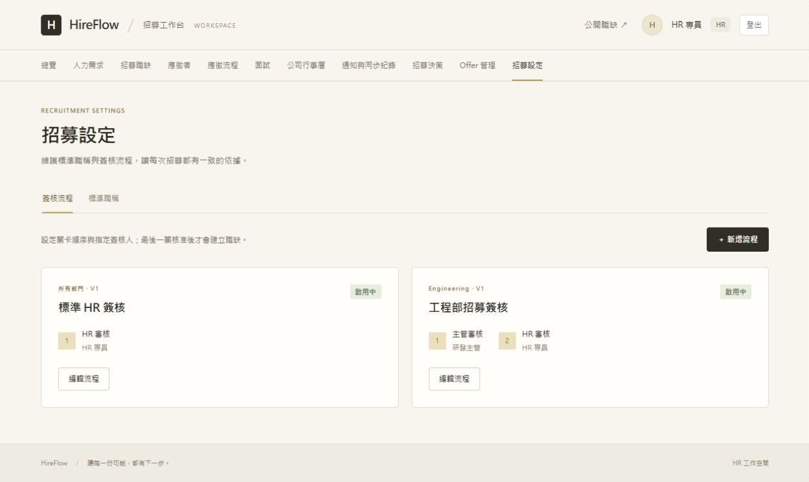

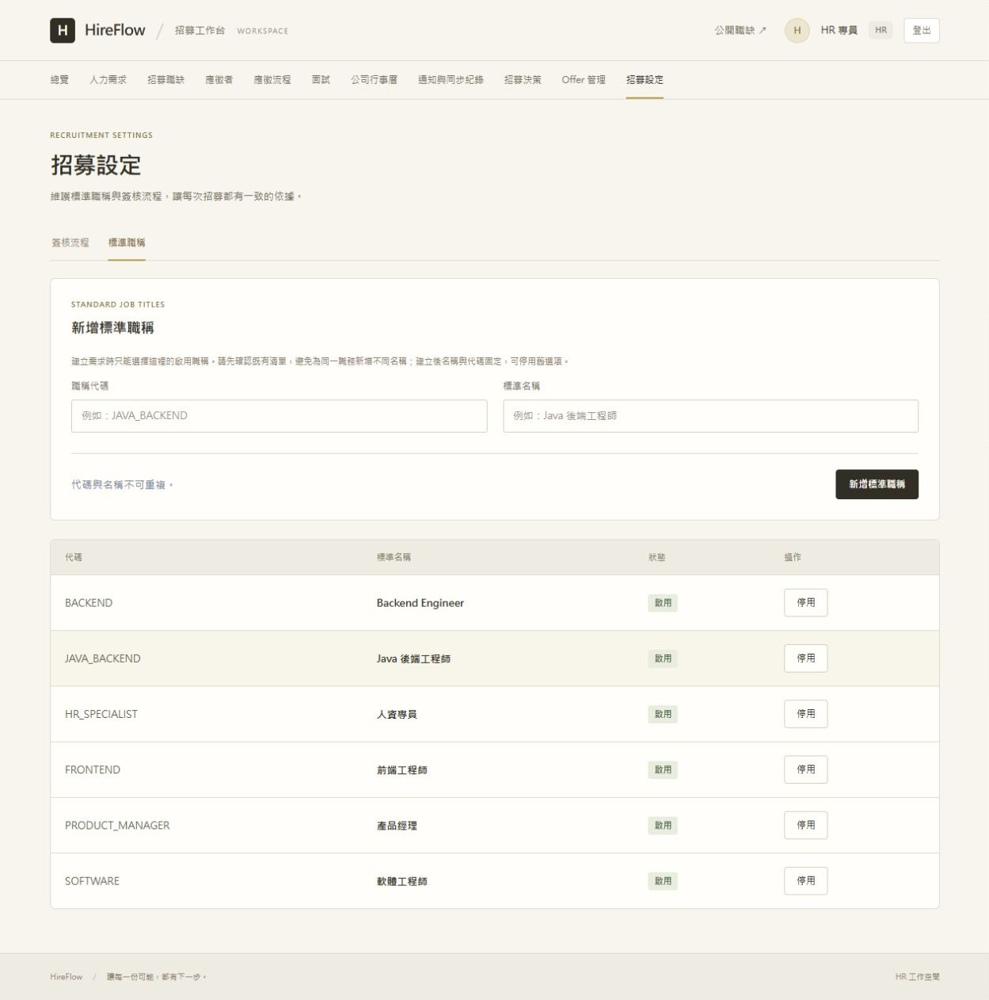

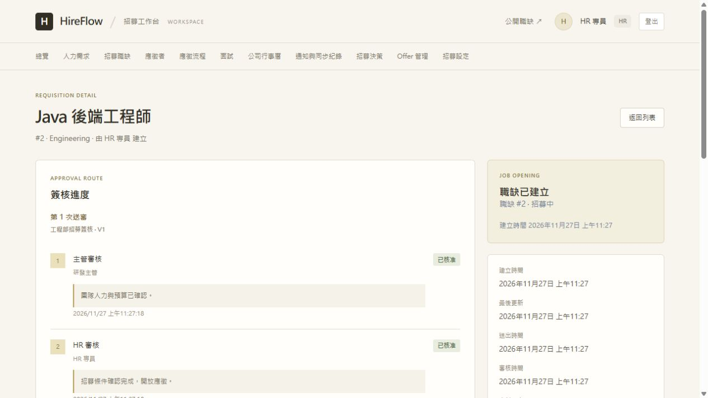

</details>

<details>
<summary>查看招募決策、Offer 與求職者進度</summary>

公司端以搜尋與分頁管理案件，查看面試評分及最終決策；求職者端顯示應徵進度、履歷附件入口與 Offer 回覆。

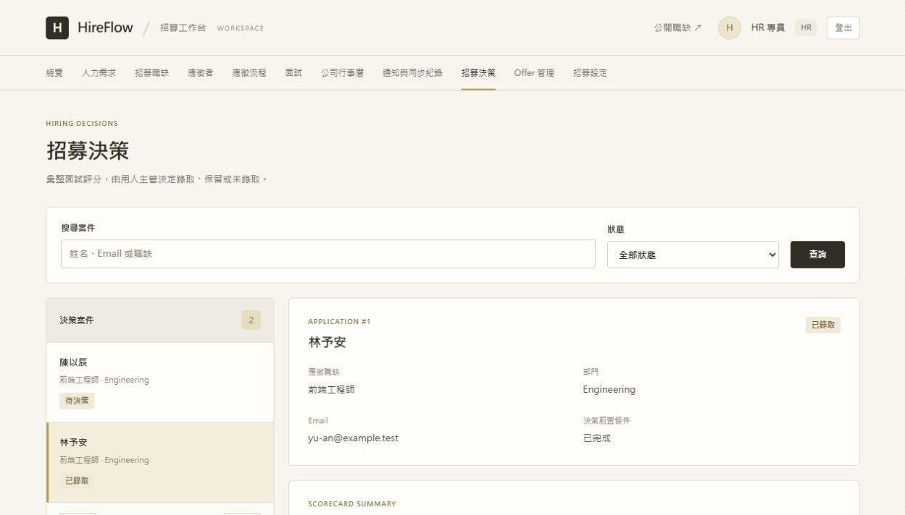

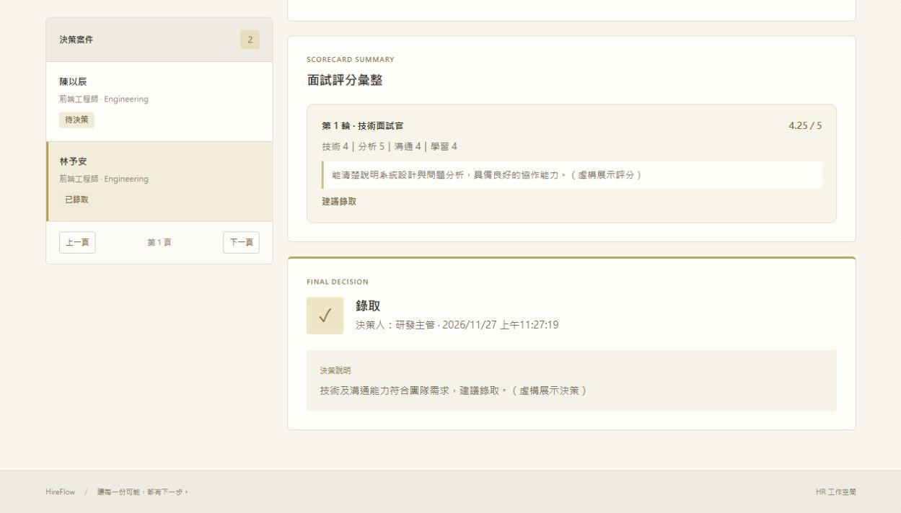

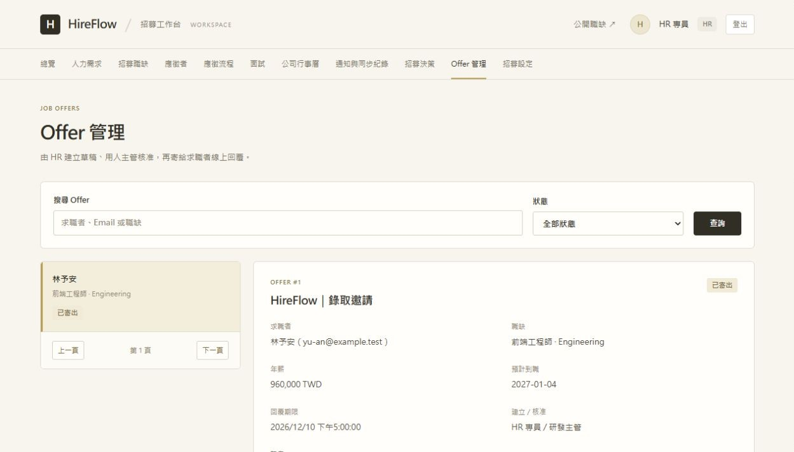

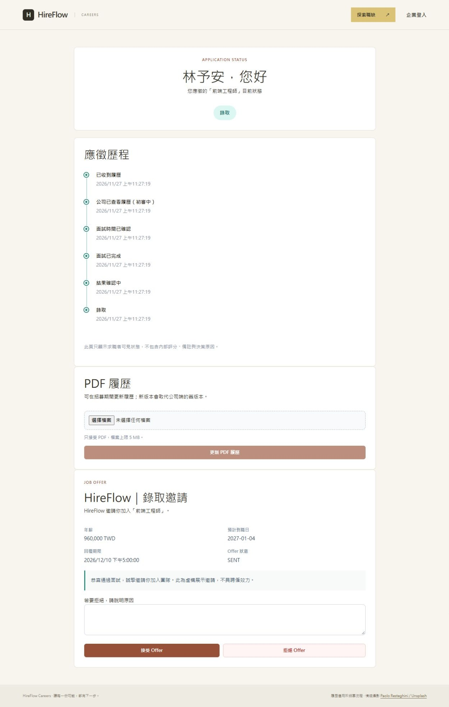

</details>

<details>
<summary>查看面試管理、改期與通知紀錄</summary>

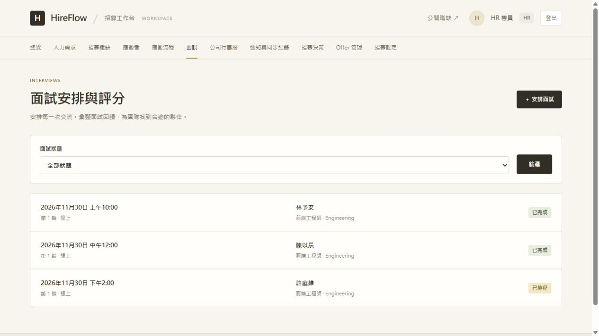

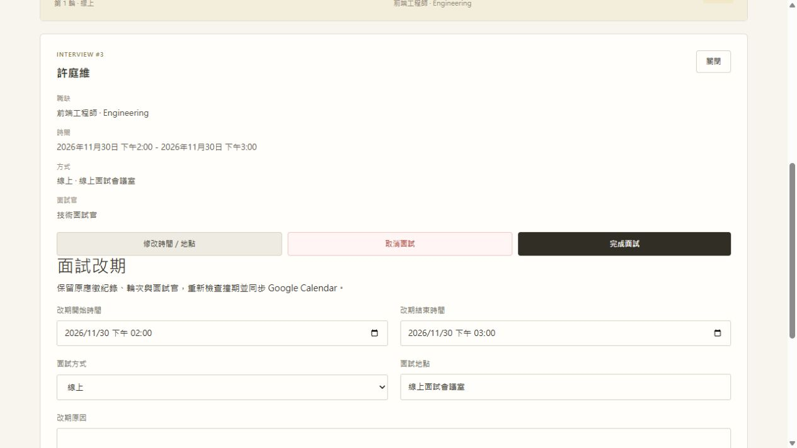

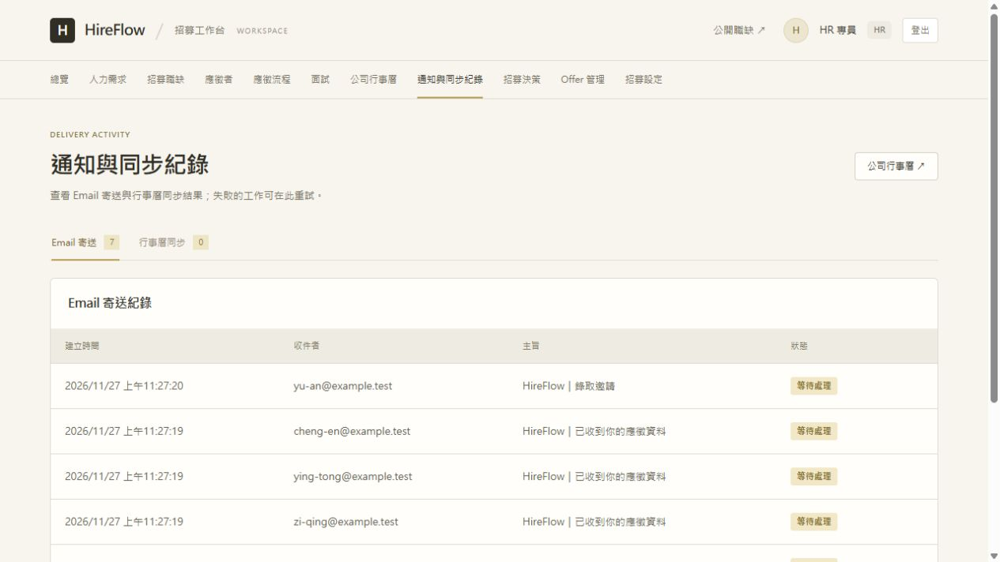

</details>

## 核心功能一覽

| 模組 | 主要功能 |
| --- | --- |
| 帳號與權限 | Session 登入、CSRF、ADMIN／HR／用人主管／面試官角色權限 |
| 人力需求 | 建立草稿、送審、HR 核准／退回／拒絕、核准後建立職缺 |
| 公開職缺 | 公開職缺列表、職缺詳情及求職者線上應徵 |
| 應徵者 | 基本履歷、自傳、作品集、多筆工作經歷及 PDF 履歷版本 |
| 應徵流程 | 招募看板、階段轉換、狀態歷程及求職者進度查詢 |
| 面試 | 面試安排、改期與地點修改、撞期檢查、面試官指派、自助選時及公司行事曆 |
| 評分與決策 | 評分表鎖定／解鎖、評分彙整、錄取／保留／不錄取、前置條件檢查及案件搜尋分頁 |
| Offer | 草稿、送審、主管核准／退回、寄送、接受／拒絕、到期提醒及案件搜尋分頁 |
| 外部整合 | Gmail SMTP、Email Outbox、Google Calendar OAuth 與事件同步 |
| 管理與稽核 | 通知與同步紀錄、失敗重試、全域 Audit Log 與部門資料隔離 |

## 可設定簽核與標準職稱

> 此擴充功能已於本機完成實作與自動化驗證，相關程式碼尚未同步至本 Repository。下列內容說明擴充版本的行為；目前可下載執行的功能以 Repository 內程式碼為準。新版暖色介面也尚未同步。

- **招募設定**：由 HR／管理員維護標準職稱，以及適用部門、簽核順序與各關指定簽核人。
- **統一職稱**：建立人力需求時只能選取啟用中的標準職稱，例如統一使用「Java 後端工程師」；API 接收職稱 ID，後端同步驗證，避免任意文字進入職稱欄位。
- **循序簽核**：支援 1～8 關，上一關核准後下一關才能處理，最後一關核准才建立職缺。
- **流程快照**：送審時保存流程名稱、版本、關卡與簽核人姓名，範本後續修改不影響進行中的案件。
- **退回重送**：退回需填理由，修改後建立新一輪簽核，保留舊輪次的決定與歷程；拒絕則結束申請。
- **待我簽核**：由後端依目前關卡指定人、角色及部門範圍查詢待辦。

例如工程部可使用「用人主管審核 → HR 最終核准」；其他部門可選擇不同範本。標準職稱可停用，既有需求與職缺保留歷史名稱。需求原因、技能條件與履歷經歷等描述欄位仍使用文字輸入。

詳細規則與 API 見[簽核流程與標準職稱](docs/APPROVAL_WORKFLOWS.md)。

## 技術重點

- 採用 Controller → Service → Repository → Entity 的嚴謹分層，Request／Response 使用獨立 DTO。
- 使用 Spring Security、HttpSession、BCrypt 與 CSRF Token 保護登入及狀態修改請求。
- 依角色與部門限制人力需求、面試、履歷、Offer 及公司行事曆的查詢範圍。
- 透過狀態機概念限制人力需求、Application、Interview 與 Offer 的合法轉換。
- 使用樂觀鎖與交易確保招募流程更新的一致性。
- 使用 Email Outbox 保存寄信工作，讓商業交易與外部 SMTP 呼叫解耦並支援重試。
- 透過 OAuth `state` 驗證與 AES-GCM 加密保護 Google Calendar Token。
- PDF 履歷驗證檔頭、大小與正規化路徑，避免偽造檔案、越權下載及 Path Traversal。
- 關鍵操作寫入 Audit Log，保存操作人、結果、目標資料與時間。

## 系統架構

```text
求職者／公司使用者
        │
        ▼
Vue 3 + Vite
Vue Router / Pinia / Axios / Bootstrap
        │
        │ REST API / Session / CSRF
        ▼
Spring Boot 4
Auth / Requisition / Candidate / Interview
Decision / Offer / Audit / Integration
        │
        ▼
Spring Data JPA / Hibernate / Flyway
        │
        ▼
PostgreSQL

External Services
Google Calendar OAuth 2.0 / Gmail SMTP
```

## 技術棧

### Frontend

- Vue 3、Vite、Vue Router
- Pinia、Axios、Bootstrap 5
- HTML5、CSS3、JavaScript
- Vitest

### Backend

- Java 17、Spring Boot 4
- Spring MVC、Spring Security、HttpSession
- Spring Data JPA、Hibernate、Bean Validation
- Spring Mail、Scheduler、OpenAPI／Swagger
- Maven、JUnit、Spring Boot Test、H2 Test Database

### Data & Integration

- PostgreSQL、Flyway
- Google Calendar OAuth 2.0
- Gmail SMTP
- AES-256-GCM Token Encryption
- Docker Compose
- GitHub Actions

## 安全設計

- API Secret、資料庫密碼、SMTP 應用程式密碼及 OAuth 憑證不提交至 Git。
- 真實設定放在被忽略的 `.env`，Repository 只保留 `.env.example`。
- 使用 BCrypt Hash 保存密碼，後端 Session 管理登入狀態。
- Cookie 與 Header 搭配 CSRF Token 保護狀態修改 API。
- 受保護 API 依登入狀態與權限回傳 401 或 403。
- Google Token 以 AES-256-GCM 加密後才寫入資料庫。
- Candidate Portal 以公開 UUID 搭配有期限的隨機 Token 驗證存取；資料庫只保存 Token 雜湊值。
- PDF 履歷使用 UUID 儲存名稱，並驗證檔案格式、大小與正規化路徑。
- 用人主管只能存取自己部門的招募資料、行事曆及履歷。

## Repository 結構

```text
HireFlow/
├── backend/                     # Spring Boot REST API
│   ├── src/main/java/           # 分層後端模組
│   ├── src/main/resources/      # 設定與 Flyway Migration
│   └── src/test/                # 整合測試
├── frontend/                    # Vue 3 SPA
│   ├── src/views/
│   ├── src/services/
│   ├── src/stores/
│   └── tests/
├── docs/                        # 功能、設定與驗收文件
├── .github/workflows/           # CI
├── compose.yaml                 # 本機 PostgreSQL
└── README.md
```

## 本機啟動

### 環境需求

- JDK 17
- Node.js 22 與 npm
- Docker Desktop，或自行安裝 PostgreSQL

### 1. 建立本機設定並啟動 PostgreSQL

```powershell
Copy-Item .env.example .env
docker compose up -d
```

`.env` 內的值只供本機使用，請勿提交真實的 Gmail、Google OAuth 或資料庫憑證。

預設 `local` profile 會從啟動目錄或上一層讀取 `.env`，支援在專案根目錄或 `backend/` 啟動。使用 `KEY=value` 格式，不加引號；Google 應用程式密碼移除空格。IDE／作業系統環境變數優先於 `.env`，若保留舊值需更新或移除。

### 2. 啟動 Backend

Windows：

```powershell
cd backend
.\mvnw.cmd spring-boot:run
```

macOS／Linux：

```bash
cd backend
./mvnw spring-boot:run
```

- Backend：`http://localhost:8080`
- API Health：`http://localhost:8080/api/health`
- Swagger UI：`http://localhost:8080/swagger-ui.html`

### 3. 啟動 Frontend

另開一個終端機，從專案根目錄執行。Windows PowerShell 使用 `npm.cmd`，可避免執行原則阻擋 `npm.ps1`：

```powershell
cd frontend
npm.cmd ci
npm.cmd run dev
```

macOS／Linux：

```bash
cd frontend
npm ci
npm run dev
```

- Frontend：`http://localhost:5173`
- 公開職缺：`http://localhost:5173/careers`

## Demo 登入

本機 Demo 資料初始化啟用時，四組帳號共用密碼：`HireFlow123!`。這些是展示帳號，非真實公司帳號。

| 角色 | Email | 主要權限 |
| --- | --- | --- |
| ADMIN | `admin@hireflow.local` | 全系統管理與稽核 |
| HR | `hr@hireflow.local` | 招募流程、Offer 與整合工作 |
| HIRING_MANAGER | `manager@hireflow.local` | 自己部門的需求、面試、招募決策與 Offer 簽核 |
| INTERVIEWER | `interviewer@hireflow.local` | 被指派面試的查看與評分 |

## 驗證指令

Windows PowerShell，從專案根目錄執行：

```powershell
# Backend
cd backend
.\mvnw.cmd test

# Frontend
cd ..\frontend
npm.cmd test
npm.cmd run build
```

驗證範圍：

- Backend：登入與權限、需求簽核、應徵階段、面試、評分與決策、Offer、履歷附件，以及通知派送。
- Frontend：API Service 與資料處理測試，並以 production build 檢查正式版本能否建置。
- GitHub Actions 會在 `main`、`codex/**` 與 Pull Request 執行後端測試、前端測試／建置，以及 PostgreSQL Migration 驗證。
- CI 使用獨立 PostgreSQL 17 驗證全新資料庫的 Flyway Migration 與 Hibernate Schema；H2 測試不會讀取本機 `.env` 或寄出信件。
- Gmail 連線／實際寄送與 PostgreSQL 測試需明確開啟對應環境設定；一般測試預設跳過外部服務檢查。實際測試結果以各次執行紀錄為準。

Gmail 設定完成後，可在 `backend/` 用下列指令只驗證 SMTP 登入，不寄信：

```powershell
$env:HIREFLOW_SMTP_TEST='true'
.\mvnw.cmd -Dtest=GmailConnectionIntegrationTests test
Remove-Item Env:HIREFLOW_SMTP_TEST
```

詳細功能與設定說明位於 [`docs/`](docs/)；外部整合設定見 [`整合設定`](docs/INTEGRATIONS.md)，Offer 與附件見 [`Offer 與 PDF 履歷`](docs/OFFERS_AND_ATTACHMENTS.md)。

## 專案說明

- 此 Repository 是個人全端作品集，目前以本機可完整操作與測試為目標。
- Google Calendar 與 Gmail 功能需要自行建立 OAuth／SMTP 憑證後才會實際呼叫外部服務。
- Gmail 實際寄送、Google Calendar 真實帳號授權及新增／改期／取消的派送工作已驗證；Offer 已完成 HR 建立、主管核准、寄送與求職者接受的瀏覽器驗收。驗收範圍與派送限制見 [`公開前驗收清單`](docs/PUBLIC_RELEASE_CHECKLIST.md)。
- 正式部署前仍需依實際網域、Secret Manager、TLS、物件儲存與資料庫環境調整設定。

---

Portfolio maintained by **Frank Tsao**

[GitHub：tsaoworkspace-hub](https://github.com/tsaoworkspace-hub)
